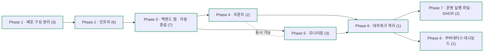

# Roadmap — k8s (쿠버네티스로 서버 자동 증설 — 그 밖은 Docker 처럼 단순하게)

## Direction

모든 앱(gateway · user-service · admin-service · scheduler · 프론트)이 사용률(CPU 70% 로 시작)에 따라 `.env` 에 정한 최소 ~ 최대 대수 사이에서 자동으로 늘고 준다. 그 밖(인프라 · 배포 장치)은 Docker 에서 돌던 것처럼 단순하게 — 로컬 k3d · 운영 k3s, Helm 차트 한 벌, 실행 명령 하나(사용자 결정 2026-11-23, 규칙은 `docs/kubernetes.md`).

## 한눈에 보는 흐름

- Phase 1 — 배포 구성 분리 · 유닛 3개 · 의존: — · 푼다: Phase 2 · 파일 집합: requests/, AGENTS.md, docs/ (+ backend · frontend 저장소) · done
- Phase 2 — 인프라 · 유닛 6개 · 의존: Phase 1 · 푼다: Phase 3 · 파일 집합: charts/infra/, deskless.sh, .env.example, README.md · done
- Phase 3 — 백엔드 앱 · 자동 증설 · 유닛 7개 · 의존: Phase 2 · 푼다: Phase 4, Phase 5 · 파일 집합: charts/backend/, deskless.sh, .env.example · done
- Phase 4 — 프론트 · 유닛 2개 · 의존: Phase 3 · 푼다: Phase 6 · 파일 집합: charts/web/ · done
- Phase 5 — 모니터링 · 유닛 3개 · 의존: Phase 3 · 푼다: Phase 6 · 파일 집합: charts/monitoring/ · done
- Phase 6 — 네트워크 격리 · 유닛 1개 · 의존: Phase 4, Phase 5 · 푼다: Phase 7 · 파일 집합: charts/*/templates/networkpolicy.yaml · done
- Phase 7 — 운영 실행 파일 · GHCR · 유닛 2개 · 의존: Phase 6 · 푼다: — · 파일 집합: deskless-server.sh, deskless.sh, charts/backend/, charts/web/, .env.example, README.md, docs/kubernetes.md · done
- Phase 8 — 쿠버네티스 대시보드 · 유닛 1개 · 의존: Phase 6 · 푼다: — · 파일 집합: charts/dashboard/, deskless.sh, .env.example, README.md, docs/kubernetes.md · done

동시 가능: Phase 4·Phase 5

지금: 진행 중 없음 · Next up: 없음

## 지금 할 일
모든 Phase 완료 — 클러스터에서 직접 확인
- 로컬 — .env 에 새 키 4개(LOCAL_DASHBOARD_PORT · DASHBOARD_*)를 옮기고 로컬 클러스터를 한 번 지운 뒤 .\deskless up → http://localhost:<LOCAL_DASHBOARD_PORT> 대시보드 로그인
- GHCR — .env.example 의 이미지 절을 .env 에 옮겨 GHCR_USER · GHCR_PUSH_TOKEN 을 넣고 .\deskless push gateway
- 프론트 요청서 2건(API_INTERNAL_URL · 공개 값 실행 때 읽기)을 프론트 세션에 보낸다 — 반영되면 git submodule update --remote
- 새로 할 일이 생기면 "로드맵에 추가"

## Scope & Actors

- **사용자(운영자)** — 클러스터 만들기 · 설치 · 배포 명령 실행(Claude 는 실행하지 않는다), `.env` 로 대수 · 접속정보 · 비밀값 · 여는 포트를 정한다.
- **앱** — backend 4개(gateway · user-service · admin-service · scheduler) · 프론트(web). 이미지는 각 저장소의 `Dockerfile`, 배포에 기대하는 값은 `backend/docs/architecture.md:180`.
- **조절 축(환경마다 다른 것)** — 앱별 최소 · 최대 대수(`<APP>_REPLICAS_MIN` · `_MAX`) · 증설 기준 · 인프라 설치 여부(관리형이면 끔) · 밖으로 여는 포트(로컬만) · 백업 주기 · 보관 일수 · 저장소 · Ingress 종류.

## Non-Goals / External Boundaries

- 앱 코드 변경 — backend · frontend 저장소의 일. 필요하면 요청서(`docs/requests.md`).
- 인프라 이중화 · 자동 복구 · 서버 밖 백업 복사 — 하지 않는다(Docker 와 같은 수준, 백업은 같은 서버 안 내부 복구용).
- 클러스터 설치 자체(k3d · k3s) — 저장소 파일이 아니다. README 에 명령을 적고 사용자가 실행.
- 관리형 쿠버네티스(EKS)로의 이전 — 차트가 막지만 않게(종류 이름은 `.env`) 두고, 이전 작업은 이 트랙 밖.

## Phases & Units

### Phase 1 — 배포 구성 분리 (백엔드 · 프론트에서 Docker 운영 구성을 걷어 내고 deskless 로 모으기) · depends: —
| # | Unit | Goal | Key decision | Depends | Status |
|---|------|------|--------------|---------|--------|
| 1 | backend Docker 정리 · 모니터링 이전 · 헬스 체크 요청 | compose · nginx · 공용 네트워크 · 모니터링 설정을 지우고 `/health/*` 추가 — 원본은 backend `3125886` | — | — | done(43abf2d) |
| 2 | frontend Docker 정리 · 헬스 체크 요청 | `docker-compose.yml` 을 지우고 지표 포트에 `/health/*` | — | — | done(7dd9da9) |
| 3 | 저장소 규칙 정리 | `AGENTS.md` · `docs/kubernetes.md` · `docs/requests.md` — 자동 증설 목적 · 요청서 규칙 | — | 1, 2 | done(aec725d) |

**Expected commands**:

| Unit | Command | Purpose |
|------|---------|---------|
| #1 · #2 | `git submodule update --remote` | 반영된 하위 저장소 받기 |

### Phase 2 — 인프라 (PostgreSQL · RabbitMQ · Redis 를 파드 1개씩 띄워 로컬 개발을 되살리기) · depends: Phase 1
| # | Unit | Goal | Key decision | Depends | Status |
|---|------|------|--------------|---------|--------|
| 4 | 실행 명령 뼈대 `deskless.sh` | `.env` → Secret → `helm upgrade --install`, `KUBE_CONTEXT` 필수 · 필수 키 확인 — 이후 Phase 가 같은 스크립트에 하위 명령을 더한다(재사용) | bash 하나(Windows Git Bash · 서버 bash) | — | done(684cb66) |
| 5 | PostgreSQL | 옛 compose 와 같은 이미지 · 설정, 노드 고정 폴더 | 이미지 패치 버전 고정 | 4 | done(684cb66) |
| 6 | RabbitMQ + 앱 계정 | 관리자 · 앱 계정 3개 · 권한 = 옛 `init.sh` 그대로(설치 뒤 1회 Job) | — | 4 | done(684cb66) |
| 7 | Redis | AOF · 비밀번호 | — | 4 | done(684cb66) |
| 8 | PostgreSQL 백업 | 하루 1번 덤프 · 7일 보관 · `.env` 로 주기 · 보관 일수, 같은 서버 안 | 기본 03:00 한국 시각 | 5 | done(684cb66) |
| 9 | 로컬 클러스터 안내 · `.env.example` | k3d 생성 명령(PC `127.0.0.1` 5432 · 5672 · 15672 · 6379, 데이터 볼륨) · 인프라 키 · 로컬 기본값 = 백엔드 `.env.example` | — | 4 | done(684cb66) |

**Expected commands**:

| Unit | Command | Purpose |
|------|---------|---------|
| #4 | `./deskless.sh infra up` · `status` · `down` | 인프라 설치 · 상태 · 지우기(데이터는 남김) |
| #8 | `./deskless.sh infra backup` | 지금 백업 한 번 |
| #9 | `k3d cluster create deskless …` | 로컬 클러스터 만들기(README — 사용자 실행) |

### Phase 3 — 백엔드 앱 · 자동 증설 (backend 4개를 클러스터에 올리고 대수가 자동으로 늘고 줄게) · depends: Phase 2
| # | Unit | Goal | Key decision | Depends | Status |
|---|------|------|--------------|---------|--------|
| 10 | 로컬 이미지 공급 | backend `Dockerfile` 로 `APP` 4개를 빌드해 로컬 클러스터에 넣기 | Tilt 로 갈지, 스크립트 빌드 + `k3d image import` 로 갈지 | — | done(173c26f) |
| 11 | 앱 설정 주입 | backend `.env` 키를 Secret · ConfigMap 으로 — 앱이 쓰지 않는 비밀값은 주지 않는다 | 앱별 키 나누기 | — | done(173c26f) |
| 12 | 앱 4개 Deployment · Service | 컨테이너 포트 · 바인딩 0.0.0.0 · 서비스 주소 · 인스턴스 ID · 지표 포트 9464 · 프로브 `/health/*` · 종료 유예 | — | 10, 11 | done(173c26f) |
| 13 | 마이그레이션 Job | user-service 마이그레이션 · 시드 — 적용은 사용자 | 설치 때마다 돌지, 명령으로만 돌지 | 12 | done(173c26f) |
| 14 | 공용 파일 볼륨 | gateway · user-service · admin-service 가 같은 `/app/storage/files`(노드 1대) | — | 12 | done(173c26f) |
| 15 | Ingress (gateway) | 공개 주소 · `/ws/` 업그레이드 · 업로드 10MB · SSE 버퍼링 끔 · 읽기 대기 120초 · `TRUST_PROXY` | 접속 주소 모양(아래 Open Decisions) | 12 | done(173c26f) |
| 16 | 자동 증설 | 앱마다 `<APP>_REPLICAS_MIN` · `_MAX`(기본 gateway · user-service 2 ~ 4, 나머지 1 ~ 1) — 다르면 HPA(CPU 70%), 같으면 고정 | CPU 요청값(70% 의 기준 — 코어 1개) | 12 | done(173c26f) |

**Expected commands**:

| Unit | Command | Purpose |
|------|---------|---------|
| #10 · #12 | `./deskless.sh backend up` · `status` · `down` | 백엔드 이미지 · 설치 · 상태 |
| #13 | `./deskless.sh backend migrate` | 마이그레이션 · 시드 적용(사용자) |
| #16 | `kubectl get hpa -n deskless` | 대수 · 사용률 확인 |

### Phase 4 — 프론트 (web 을 클러스터에 올리기) · depends: Phase 3
| # | Unit | Goal | Key decision | Depends | Status |
|---|------|------|--------------|---------|--------|
| 17 | 프론트 이미지 | frontend `Dockerfile` — 빌드 secret `dotenv`(`NEXT_PUBLIC_*` 는 빌드 때 박힌다) | 빌드용 `.env.production` 을 어디서 받을지 | — | done(5fabd60) |
| 18 | web Deployment · Service · Ingress 경로 · 자동 증설 | 포트 5000 · 지표 포트 · 프로브 · `WEB_REPLICAS_MIN` · `_MAX` | — | 17 | done(5fabd60) |

**Expected commands**:

| Unit | Command | Purpose |
|------|---------|---------|
| #17 · #18 | `./deskless.sh web up` · `status` · `down` | 프론트 이미지 · 설치 · 상태 |

### Phase 5 — 모니터링 (옛 백엔드 모니터링을 클러스터로 옮기기) · depends: Phase 3
| # | Unit | Goal | Key decision | Depends | Status |
|---|------|------|--------------|---------|--------|
| 19 | Prometheus | 쿠버네티스에서 앱 파드 찾기 · 표시 이름 `display_name` · 기록 규칙(원본 backend `3125886:docker/prometheus/`) | 직접 만든 차트로 갈지, kube-prometheus-stack 으로 갈지 | — | done(5fabd60) |
| 20 | Grafana | 서비스 부하(판정 표) · 인프라 대시보드 2개 · 한국어 화면 · 홈(원본 `3125886:docker/grafana/`) | — | 19 | done(5fabd60) |
| 21 | 수집기 | PostgreSQL · Redis 수집기 · RabbitMQ 지표 플러그인(15692) | — | 19 | done(5fabd60) |

**Expected commands**:

| Unit | Command | Purpose |
|------|---------|---------|
| #19 · #20 | `./deskless.sh monitoring up` · `status` · `down` | 모니터링 설치 · 상태 |
| #20 | `kubectl port-forward` → Grafana | 대시보드 보기 |

### Phase 6 — 네트워크 격리 (서비스는 gateway 만, 인프라는 앱만 닿게) · depends: Phase 4, Phase 5
| # | Unit | Goal | Key decision | Depends | Status |
|---|------|------|--------------|---------|--------|
| 22 | NetworkPolicy | 옛 internal 네트워크 대응 — user-service · admin-service 는 gateway 만, 인프라는 앱 · 수집기만, 지표 포트는 Prometheus 만 | — | — | done(c9ae9bb) |

**Expected commands**:

| Unit | Command | Purpose |
|------|---------|---------|
| #22 | `kubectl get networkpolicy -n deskless` | 정책 확인 |

### Phase 7 — 운영 실행 파일 · GHCR (리눅스 서버에서 Docker 없이 k3s 로 같은 원클릭, 이미지는 GHCR 로 주고받기) · depends: Phase 6
| # | Unit | Goal | Key decision | Depends | Status |
|---|------|------|--------------|---------|--------|
| 23 | 운영 실행 파일 | 리눅스 서버에서 `git clone` → `./deskless-server.sh setup`(k3s · helm · nerdctl(BuildKit) · 값 파일 — 새 `.env` 는 `KUBE_CONTEXT=default` · `IMAGE_SOURCE=registry`) → `up`(같은 `.env` 키 · 같은 묶음 · 같은 차트 — `deskless.sh` 를 운영 모드로) | 서버마다 다른 값은 `.env` "이 서버" 절 · 서버 빌드도 남겨 둔다(막지 않는다) | — | done(6660711) |
| 24 | GHCR 이미지 올리기 · 받기 · 한 대씩 교체 | 서비스 단위 `push [서비스…]` · `up [서비스…]`(고른 것만 새 태그, 나머지는 떠 있는 태그 그대로) · `restart [서비스…]`, 태그 = 하위 저장소 커밋 12자리, 받기 Secret · RollingUpdate(`maxSurge 1` · `maxUnavailable 0`). 프론트 공개 값은 실행 때(요청서) | 올리기 · 받기 키 둘 다 `.env` — PC · 서버 어디서나(사용자 2026-11-24), 비어도 로컬 build 실행 영향 없음 · 웹은 방안 b(이미지 하나) | 23 | done(6660711) |

**Expected commands**:

| Unit | Command | Purpose |
|------|---------|---------|
| #23 | `./deskless-server.sh setup` · `./deskless-server.sh up` | 서버 준비 · 전부 설치 |
| #24 | `.\deskless push gateway web` → `git pull --recurse-submodules && ./deskless-server.sh up gateway web` · `./deskless-server.sh restart web` | 올리기 → 받아 한 대씩 교체 · 다시 받기 |

### Phase 8 — 쿠버네티스 대시보드 (클러스터 화면을 브라우저로 — 로그인 뒤) · depends: Phase 6
| # | Unit | Goal | Key decision | Depends | Status |
|---|------|------|--------------|---------|--------|
| 25 | 쿠버네티스 대시보드(웹) | Headlamp 웹 1대 + 로그인 문지기(nginx Basic 인증 — `.env` 의 `DASHBOARD_USER` · `DASHBOARD_PASSWORD`), 로컬은 PC `LOCAL_DASHBOARD_PORT`(14466), 운영은 port-forward | 직접 만든 차트(공식 차트 없이) · 들어온 사람은 ServiceAccount 권한 하나(기본 `cluster-admin`) · Headlamp 는 파드 안 127.0.0.1 에만(사용자 2026-11-24) | — | done(6660711) |

**Expected commands**:

| Unit | Command | Purpose |
|------|---------|---------|
| #25 | `./deskless.sh dashboard up` · `status` · `down` | 대시보드 설치 · 주소 · 지우기 |

**Progress**: 25/25 units done (8/8 phases)
**Next up**: 없음 — 모든 Phase 완료

## Cross-Cutting Rules

- 로컬 · 운영 파일을 나누지 않는다 — 차트 · values 한 벌, 환경 차이는 그 PC · 서버의 값 파일(새 키는 `.env.example` 에 로컬 기본값과 함께). 값 파일은 주인별로 — deskless `.env` 는 클러스터 몫, 앱 값은 하위 저장소의 `.env`(같은 값을 두 번 적지 않는다).
- 브라우저 공개 주소는 deskless `.env` 의 `GATEWAY_PUBLIC_URL` · `WEB_PUBLIC_URL` 한 곳 — 앱의 주소 키에 넣는다. 로컬은 비우면 PC 포트(`LOCAL_GATEWAY_PORT` · `LOCAL_WEB_PORT` — 기본 13000 · 15000, PC `npm` 의 3000 · 5000 과 따로)의 `localhost` 주소.
- PC · 사용자마다 다른 값(경로 · PC 포트 · 볼륨 · k3s 인자 · 기다리는 시간)은 실행 파일에 고정하지 않고 `.env` 의 "이 PC" 절 — 다른 환경도 `.env` 만 고쳐 같은 실행 · 확인(사용자 2026-11-24).
- 실행은 `deskless.sh` 하나로 — 전부는 원클릭 `up`(먼저 모두 확인 · 로컬 클러스터부터, 묶음이 늘면 `up` 과 그 확인에 더한다), 묶음별은 `<묶음> <동작>` — 묶음마다 하위 명령을 더하고, 모든 명령은 `.env` 의 `KUBE_CONTEXT` 로만 클러스터에 닿는다.
- 앱 대수는 앱마다 `<APP>_REPLICAS_MIN` · `_MAX`(모든 앱 기본값) — 다르면 HPA, 같으면 고정. 증설 기준은 CPU — 부하율(이벤트 루프 사용률)은 Grafana 판정용이고 증설 기준으로 쓰지 않는다(Node 는 CPU 와 거의 같이 움직이고 부품이 늘지 않는다 — 사용자 2026-11-24, 큐 적체로 늘려야 할 때가 오면 KEDA).
- Ingress 종류 · 저장소 종류 이름은 차트에 고정하지 않는다(`.env`).
- 데이터 관리 도구 컨테이너는 넣지 않는다(PC 앱) — 예외 RabbitMQ 관리 화면 · 모니터링 · 쿠버네티스 대시보드(로그인 문지기 뒤).
- 앱이 배포에 기대하는 값은 `backend/docs/architecture.md:180` 을 따르고, 앱 쪽을 바꿔야 하면 요청서.
- 운영 이미지는 GHCR — 서비스 단위로 올리고(`push`) 받아 한 대씩 교체(`up <서비스…>`), 태그 = 하위 저장소 커밋. 일부 명령만 쓰는 키(이미지 · GHCR · "이 서버")는 그 명령에서만 확인한다(사용자 2026-11-24).
- 클러스터 · 설치 · 올리기 명령은 사용자가 실행 — Claude 는 `helm lint` · `helm template` · `bash -n` · 가짜 도구 확인까지.

## Open Decisions (roadmap-level)

- [x] 로컬 이미지 공급 — `deskless.sh` 빌드 + `k3d image import`(사용자 2026-11-23 — 더 설치할 도구 없이 단순하게, Tilt 는 쓰지 않음) (Phase 3 · 4)
- [x] 접속 주소 모양 — 주소를 따로: 로컬 클러스터 `localhost:13000`(gateway) · `:15000`(프론트) — PC `npm` 실행(3000 · 5000)과 부딪히지 않게, 운영 도메인 둘(api.<도메인> · <도메인>). 공개 주소는 deskless `.env` 의 `GATEWAY_PUBLIC_URL` · `WEB_PUBLIC_URL` 이 정해 앱 주소 키에 넣는다 — Phase 4 는 프론트 주소 키 · 카카오 · 네이버 콜백(15000) 등록(사용자 2026-11-23) (Phase 3 · 4)
- [x] 마이그레이션 — `backend up` 때마다 앱보다 먼저 자동(옛 compose migrate 와 같다), 따로는 `backend migrate`(사용자 2026-11-23) (Phase 3)
- [x] 앱 값 파일 — deskless 가 받아 둔 하위 저장소 사본의 `.env`(`.env.example` 복사)에서 읽고 deskless `.env` 에는 클러스터 몫만, 같은 값을 두 번 적지 않는다(사용자 2026-11-23). 백엔드 · 프론트는 독립 프로젝트라 작업 폴더의 `.env` 와는 따로 둔다(사용자 2026-11-24 — 백엔드 `backend/.env`, 프론트는 Phase 4 에서 같은 방식) (Phase 3 · 4)
- [x] 모니터링 방식 — 직접 만든 차트(옛 compose 그대로 + 앱 파드 자동 찾기), kube-prometheus-stack 은 쓰지 않는다. 로컬은 PC 입구 Grafana 13001 · Prometheus 19090, 운영은 port-forward(사용자 2026-11-24) (Phase 5)
- [x] 프론트 서버 쪽 게이트웨이 주소 — 프론트에 요청서(`API_INTERNAL_URL`, 비면 `NEXT_PUBLIC_API_URL`), 차트가 `http://gateway:3000`. 프론트 값 파일은 `frontend/.env.production`, 없으면 `frontend/.env`(사용자 2026-11-24) (Phase 4)
- [x] 운영 이미지 — GHCR(`<IMAGE_REGISTRY>/deskless-<서비스>:<커밋>`), 보통 PC 올리기 · 서버 받기 — 양쪽 다 막지 않는다. 서버 안 빌드(`IMAGE_SOURCE=build` — nerdctl → k3s)도 남겨 둔다. 웹은 공개 값을 실행 때 읽어 이미지 하나(방안 b — 프론트 요청서)(사용자 2026-11-24) (Phase 7)

## Notes / Risks

- 운영 `.env` 점검(기본 비밀번호 · 테스트 데이터 · `localhost` 주소가 남으면 멈춤) · HTTPS(인증서)는 하지 않기로 했다(사용자 2026-11-24 — 권장 중단). 필요해지면 새 Phase 로.
- 웹 이미지는 프론트가 공개 값을 실행 때 읽기(요청서 `requests/frontend/2026-11-24-runtime-public-env.md`) 전까지 올린 쪽의 공개 주소가 박힌다 — 그때까지 운영용 웹은 서버에서 `push`.

- `helm` v4.3.2 · `k3d` v5.9.0(k3s 1.35) 설치됨(2026-11-23) — 실제 클러스터 설치 확인(Phase 2 인프라)은 사용자가 아직.
- 로컬 Docker Desktop(WSL2 커널 5.15)은 cgroup v1 — k3s 1.35 kubelet 이 거부해 클러스터 만들기에 `--kubelet-arg=fail-cgroupv1=false` 를 붙였다(2026-11-23). WSL 이 cgroup v2 가 되면 뺀다.
- 공용 파일 볼륨은 노드 1대 전제 — 서버가 여러 대가 되면 S3 모드(백엔드 `AWS_S3_BUCKET`)로.
- 로컬 PC 자원(Docker Desktop 메모리 · CPU) — 앱 최대 대수 · 인프라를 모두 띄우면 무거울 수 있다. 로컬 `.env` 로 대수를 낮춘다.
- 원본 배포 파일은 backend `3125886` 에 있다 — `git -C backend show 3125886:<파일>`.
